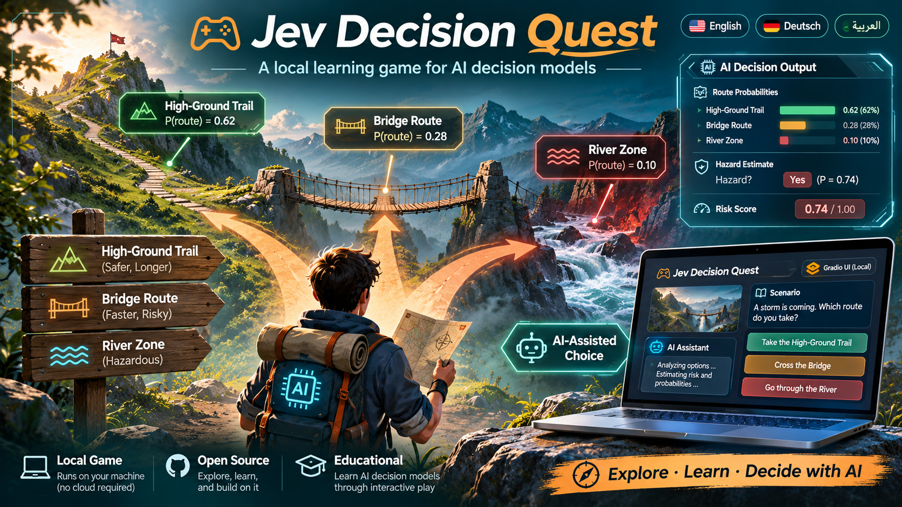
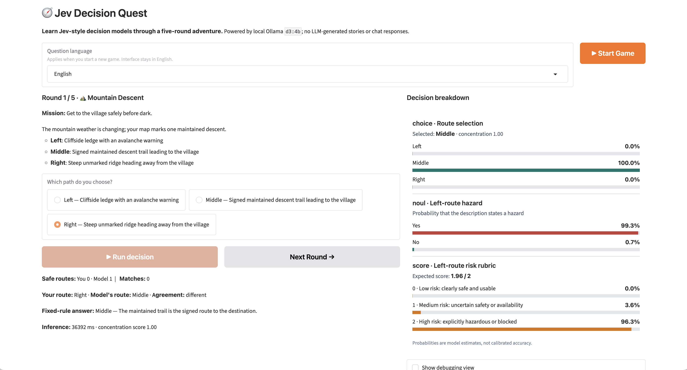
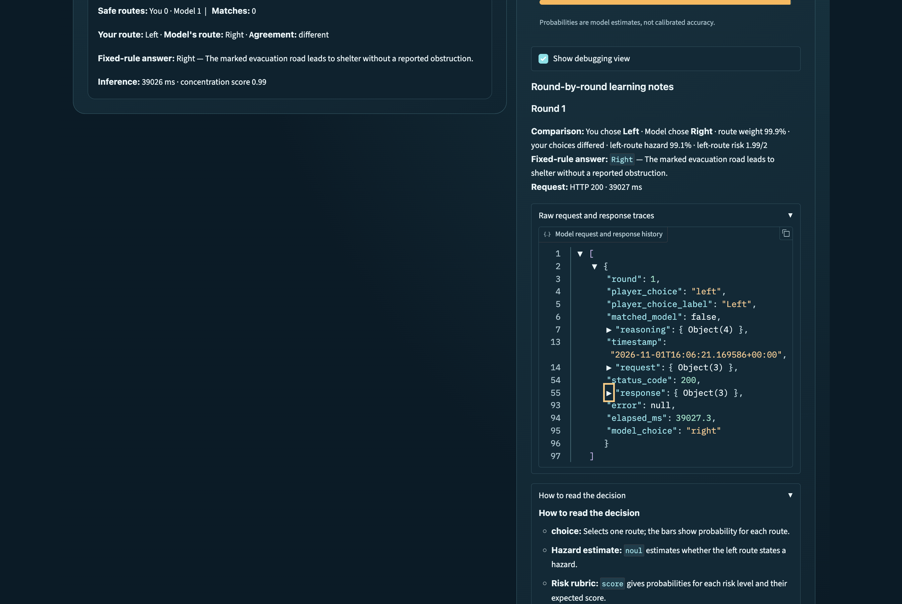
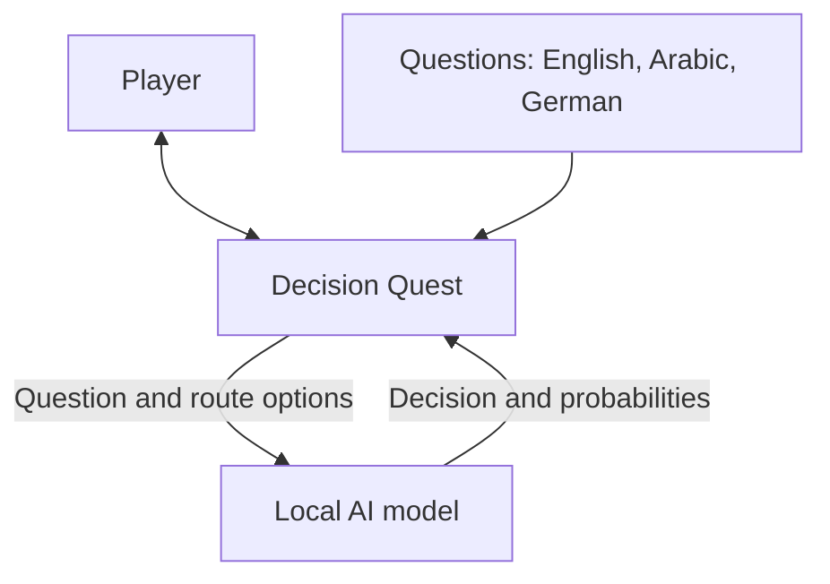
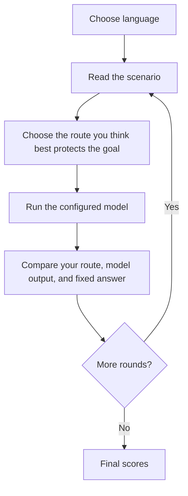
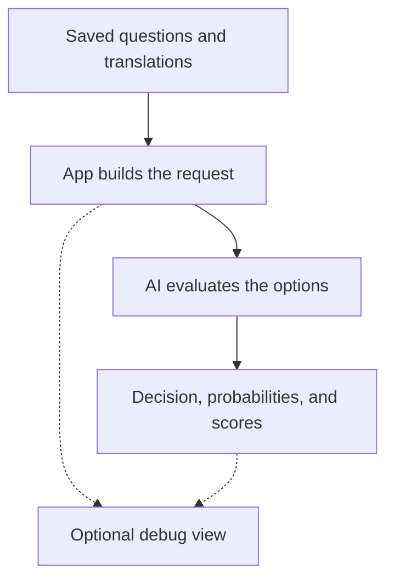

# Jev Decision Quest - Gradio + Ollama

A **local, turn-based learning game** for Jev-style decision models, using Ollama's `/v1/systemone` endpoint. In each of five short adventures, choose a route before running the configured model, then compare your choice and the model's decision against the fixed game answer.



> **Illustrative poster:** this artwork is promotional and is not a screenshot of the current app. The screenshots below show the actual interface.

## Screenshots

### Game view



### Decision breakdown and explanation



The explanation shown is authored from fixed game rules. The model returns structured decisions and probabilities, not natural-language reasoning.

## Requirements

- Ollama **0.35.0+** running locally
- D3 4B model downloaded with `ollama pull d3:4b`
- Python 3.10+

## Setup

```bash
ollama pull d3:4b
python -m venv .venv
source .venv/bin/activate          # Windows: .venv\Scripts\activate
pip install -r requirements.txt
python app.py
```

Open **<http://127.0.0.1:7860>**.

You can override the local server or model using `OLLAMA_URL` and `OLLAMA_MODEL` environment variables.
The default model is `d3:4b`; use the exact tag shown by `ollama list`.
Requests allow 300 seconds for model loading and inference. Set `OLLAMA_TIMEOUT`
to change this timeout in seconds.

## Question languages

Select **English**, **Arabic — العربية**, or **German — Deutsch** under
**Question language**, then click
**Start Game**. The selection applies for the entire game. Arabic and German include all
eight scenario titles, missions, stories, route choices, answer explanations,
and the decision questions sent to the configured model. Interface labels, buttons, scores,
and status messages remain in English. Arabic question content displays right to left.

Question content lives in `decision_quest/locales/en.json`, `ar.json`, and `de.json`.
The English catalog is the default and provides fallback text for missing translations.
To add another language,
create a catalog with the same structure and register its code in `LANGUAGES`
in `decision_quest/localization.py`. Missing content falls back to English;
route identifiers and answer keys remain shared across languages.

## Code structure

```text
app.py                       # Entry point: python app.py
decision_quest/
    __init__.py
    config.py                # Environment settings and game constants
    localization.py          # Question language selection and catalog loading
    locales/en.json          # English question content and fallback
    locales/ar.json          # Arabic question translations
    locales/de.json          # German question translations
    scenes.py                # Scenario identifiers and fixed answer keys
    ollama.py                # Model requests and response validation
    game.py                  # Round lifecycle, scoring, and event handlers
    presentation.py          # Markdown and probability chart formatting
    ui.py                    # Gradio layout and event wiring
    styles.css               # Poster-inspired colors, cards, and responsive layout
test_app.py                  # Game flow regression tests
```

Run the tests without Ollama:

```bash
python -m unittest -v test_app
```

## Architecture

The player uses the app, which loads saved questions and asks a local AI model
to evaluate the available routes.



## What it teaches

- **choice**: The model selects a route from three predefined options and returns option probabilities.
- **noul**: The model estimates whether the left route explicitly presents a hazard.
- **score**: The model estimates left-route risk on an ordered 0–2 rubric and returns probabilities for each level.
- **Inference latency**: milliseconds per request, including any cold-start time.
- **Rule-based validation**: game logic, rather than the AI, defines a safe route and the score.

Game instructions and static rules are entirely deterministic; the model does not learn or update weights during play. Probabilities and the model's `confidence` concentration score are **not** calibrated chances of being correct. All UI elements are local to your machine.

Based on [Ollama's official Jev-style decision models announcement](https://ollama.com/blog/ollama-now-supports-jev-style-decision-models) and the [Nimble model reference](https://ollama.com/library/nimble).

## Debugging

Check **Show debugging view** for concise per-round decision summaries and the
fixed-rule answer explanation. Expand **Raw request and response traces** to
inspect each attempt's timestamp, endpoint, request JSON, HTTP status, response,
elapsed time, and any error. The explanation is authored game content, not
reasoning generated by the model. Failed requests remain visible and can be retried.
Uncheck the box to hide the panel. History is kept in the current session across
rounds and cleared by **Start Game**; it is not written to disk.

## How a question becomes a request and response

The locale catalogs contain the authored question content. The app combines
that content with the API structure built by Python to construct the request
before calling the model.

1. **Start a game:** `game.py` saves the selected language and randomly chooses
   five scenario IDs. `scenes.py` owns the fixed correct route for each scenario.
2. **Load question content:** `localization.py` loads `en.json`, then overlays
   the selected catalog, such as `ar.json`. Missing translated fields retain
   their English values. No model call or automatic translation happens here.
3. **Show the scenario:** `presentation.py` formats its title, mission, story,
   and route choices. Buttons, status text, and interface labels stay in English.
4. **Build the request:** clicking **Run decision** calls `build_payload()` in
   `ollama.py`. It maps the localized content into the `/v1/systemone` API format
   and adds the configured model name, currently `d3:4b` by default.
5. **Run inference:** Ollama returns structured decisions and numeric results.
   The app records the response; it does not add probabilities or scores to it.
6. **Score the round:** `game.py` compares the returned route with the fixed
   answer key. The displayed explanation comes from the locale's `reason` field.
   Neither that explanation nor the correct answer is sent in the request.

### Game flow



### Question and result context

Question text is saved in the language catalogs. The AI returns decisions and
numbers. Check **Show debugging view** to inspect their request and response.


