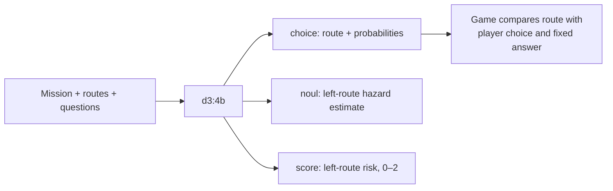

# Learning Jev Models · Three Rounds

These exchanges summarize player choices and structured JSON from **`d3:4b`**. The model evaluated each scenario without seeing the player's choice or the correct answer.

| Jev type | How to read it |
| --- | --- |
| `choice` | Selects a route and returns probabilities for the options. |
| `noul` | Estimates whether the left route has an explicit hazard or blockage; higher means “yes.” |
| `score` | Estimates left-route risk: **0 = low**, **1 = medium**, **2 = high**. Decimals are probability-weighted averages. |

**Hazard and risk always refer to the left route.** Route probability is not a verified chance of correctness.

## Round 1 · Forest Evacuation

**Routes:** Left enters an active wildfire; middle ends at a river with no crossing; right follows an open evacuation road to shelter.

**Player**

> I choose **right**: the open ranger-marked evacuation road to the shelter.

**Model — Right**

- **Route probability:** 99.89%
- **Left-route hazard estimate:** 99.10%
- **Left-route risk score:** 1.99 / 2

**Learning note:** The model selects right while identifying the rejected left route as high risk.

## Round 2 · Volcano Research Base

**Routes:** Left uses a protected tunnel to shelter; middle crosses an active lava-flow exclusion zone; right crosses an unstable slope with recent rockfalls.

**Player**

> I choose **left**: the protected tunnel directly to the observation shelter.

**Model — Left**

- **Route probability:** 99.99%
- **Left-route hazard estimate:** 0.04%
- **Left-route risk score:** 0.01 / 2

**Learning note:** Here, the selected route is also the route assessed as low risk.

## Round 3 · Space Station

**Routes:** Left is depressurized with a vacuum alarm; middle is pressurized and leads to the escape pod; right is blocked by a jammed hatch.

**Player**

> I choose **middle**: the pressurized corridor leading to the escape pod.

**Model — Middle**

- **Route probability:** 99.997%
- **Left-route hazard estimate:** 97.96%
- **Left-route risk score:** 1.94 / 2

**Learning note:** Middle meets both requirements: pressurized and passable. The high risk score still describes left.

Both player and model matched the fixed answer in **3/3 rounds**. These notes explain the results; the model returned structured decisions, while `reasoning.explanation` comes from fixed game rules. See the [JSON traces](reasoning-traces.json) for the original outputs.
